# 🍈 Durian Ripeness Classification via Cross-Modal Knowledge Distillation (CMKD)

[](https://www.python.org/)
[](https://pytorch.org/)
[](https://huggingface.co/docs/timm)
[](https://streamlit.io/)
[](https://doi.org/10.5281/zenodo.18603796)

An end-to-end **Cross-Modal Knowledge Distillation (CMKD)** and **Learning Under Privileged Information (LUPI)** system for non-destructive durian (*Durio zibethinus*) ripeness grading across three physiological stages: **`Unripe`**, **`Ripe`**, and **`Overripe`**.

During offline training, a **Multi-Modal Teacher** fuses **multi-view external RGB fruit bags** (`ConvNeXt V2-Base + 256-D Projection + Lightweight Gated Attention`), acoustic knock resonance, thermal imaging, near-infrared (NIR) multispectral bands, and laboratory physicochemical measurements. Knowledge is then distilled—via confidence-weighted soft logits and relational feature-space alignment—into a **Vision-Only Multi-View Student** (`ConvNeXt V2-Base` + `256-D` Projection + Gated Attention) that operates in real-world deployment **using RGB images alone**, with no microphones, thermal cameras, or destructive laboratory sensors required.

---

## Table of Contents
1. [Project Overview](#1-project-overview)
2. [Repository Structure](#2-repository-structure)
3. [Dataset Description](#3-dataset-description)
4. [Model Architecture & CMKD Framework](#4-model-architecture--cmkd-framework)
5. [Installation, Pretrained Checkpoints & Quickstart](#5-installation-pretrained-checkpoints--quickstart)
6. [Dataset Download & Retraining Pipeline](#6-dataset-download--retraining-pipeline)
   - [Training on Google Colab (Interactive GPU Notebooks)](#training-on-google-colab-interactive-gpu-notebooks)
7. [Running the Interactive Streamlit Dashboard](#7-running-the-interactive-streamlit-dashboard-step-by-step-guide)
8. [Exploratory Data Analysis (EDA) Report](#8-exploratory-data-analysis-eda-report)
9. [Experimental Results (Vision Baselines, Unimodal, Teacher & Student)](#9-experimental-results-vision-baselines-unimodal-teacher--student)
10. [Interactive Streamlit Dashboard & Visualizations](#10-interactive-streamlit-dashboard--visualizations)
11. [Citation & Acknowledgments](#11-citation--acknowledgments)
12. [Contributors & Team Members](#12-contributors--team-members)

---

## 1. Project Overview

Non-destructive durian ripeness grading from external appearance alone is notoriously challenging because spine morphology and peel hue vary subtly across cultivars and lighting, whereas internal pulp softening and flesh-husk detachment are strongly expressed in **acoustic knock resonance** and **physicochemical properties**.

This project addresses durian ripeness grading with a two-stage **Multi-View CMKD** pipeline:
- **Stage 1A — Unimodal Backbones & Vision Baseline Study:** Benchmark both **Single-View** and **Multi-View Gated Attention** vision architectures (`ResNet-50`, `DINOv3`, `ConvNeXt V2-Base`), selecting **Multi-View `ConvNeXt V2-Base` + `1024 → 256` Projection + Lightweight Gated Attention Pooling (Ilse et al., $D = 128$)** as the official Vision backbone alongside **Acoustic Knock Sound** (`ResNet-18` on 64-bin log-Mel spectrograms) and **Integrated Sensors** (`SensorBackbone` MLP over 21 tabular + thermal + multispectral features).
- **Stage 1B — Multi-Modal Teacher (`MultiModalTeacher`):** Fuse the fruit-level Multi-View RGB embedding ($F_{\text{rgb}} \in \mathbb{R}^{256}$), Acoustic embedding ($f_{\text{audio}} \in \mathbb{R}^{512}$), and Sensor embedding ($f_{\text{sensor}} \in \mathbb{R}^{32}$) via **Transformer Cross-Attention** (`CrossAttentionMultimodalFusion`) with learnable modality embeddings, adaptive modality gating, `key_padding_mask` missing-modality handling, and an ordinal **Cost-Sensitive Focal Loss** to learn a rich privileged latent representation $f_{\text{mm}} \in \mathbb{R}^{256}$.
- **Stage 2 — Vision-Only Student (`VisionStudent`):** Distill teacher-confidence-weighted soft logit distributions ($\mathcal{L}_{\text{KD}}$) and relational multimodal geometry ($\mathcal{L}_{\text{feat}}$) from the frozen Teacher into a **Multi-View RGB-only** `ConvNeXt V2-Base` Student equipped with an adaptive `ProjectionHead` $\phi(F_{\text{rgb}}) \in \mathbb{R}^{256}$, fruit-level deduplicated sampling, and Feature-Space Mixup.
- **Stage 3 — Interactive Deployment:** Serve single-image and multi-view (6-angle) fruit ripeness classification through a modular **Streamlit Dashboard** (`app.py` + `visualization/`).

---

## 2. Repository Structure

```text
durian-ripeness-classification/
├── app.py                                      # Streamlit Dashboard entrypoint (Single & Multi-View inference)
├── train_teacher.py                            # Root CLI wrapper for Stage 1B Multi-Modal Teacher training
├── train_student.py                            # Root CLI wrapper for Stage 2 Vision-Only Student distillation
├── pyproject.toml                              # Project metadata (Python >= 3.12)
├── requirements.txt                            # Python dependencies (PyTorch, timm, Streamlit, Plotly, etc.)
│
├── visualization/                              # Modular Streamlit UI & inference package
│   ├── __init__.py                             # Public package exports
│   ├── config.py                               # Paths, UI mode constants, ripeness metadata & colors
│   ├── inference.py                            # Cached model loader, get_eval_transforms(), fruit aggregation
│   ├── components.py                           # Reusable UI widgets, verdict banners & Plotly charts
│   └── result_visualization/                   # Captured Streamlit UI & inference result screenshots
│       ├── dashboard_interface.png
│       ├── input_durian_001_BOT_Unripe_rgb.png
│       ├── input_durian_001_SA_2_Unripe_rgb.png
│       ├── result_durian_001_BOT_Unripe_rgb.png
│       └── result_durian_001_SA_2_Unripe_rgb.png
│
├── src/                                        # Core shared deep learning library
│   ├── datasets/
│   │   ├── __init__.py                         # Lazy-loaded dataset package exports
│   │   ├── image_dataset.py                    # CLAHETransform (LAB L-channel), transforms & ImageDataset
│   │   ├── audio_dataset.py                    # AudioKnockBank & AudioDataset (64x306 log-Mel)
│   │   ├── sensor_dataset.py                   # 21-D C_integrated19 feature builder & SensorDataset
│   │   └── multimodal_dataset.py               # Synchronized RGB + Audio + Sensor Dataset with zero-masking
│   ├── models/
│   │   ├── vision_backbone.py                  # Multi-View ConvNeXt V2-Base + 256-D Proj + Gated Attention
│   │   ├── audio_backbone.py                   # ResNet-18 (in_chans=1) acoustic backbone wrapper
│   │   ├── sensor_backbone.py                  # LayerNorm MLP encoder for 21-D sensor features
│   │   ├── teacher_model.py                    # MultiModalTeacher & CrossAttentionMultimodalFusion
│   │   └── student_model.py                    # Multi-View VisionStudent (ConvNeXt V2-Base) & ProjectionHead
│   ├── losses/
│   │   ├── classification_loss.py              # CostSensitiveFocalLoss (Ordinal Cost Matrix), Focal & CE
│   │   └── distillation_loss.py                # CrossModalDistillationLoss (CE + KD + Relational Feat + Mixup)
│   ├── evaluators/                             # Shared evaluation hooks
│   └── utils/
│       └── common.py                           # Seed control, CLASS_ORDER, path helpers
│
├── baselines/                                  # Single-View (outputs/) vs. Multi-View (outputs_improve/) Vision Baselines
│   ├── ConvNeXtV2/                             # Single-view ConvNeXt V2-Base outputs/
│   ├── DINOv3_classification_head/             # DINOv3 ViT-B/16 single-view (outputs/) & multi-view (outputs_improve/)
│   └── ResNet-50/                              # ResNet-50 single-view (outputs/) & multi-view (outputs_improve/)
│
├── checkpoints/                                # Pretrained model weights (downloaded from Google Drive)
│   ├── studentmodal/                           # best_student.pth, last_student.pth
│   ├── teachermodal/                           # best_teacher.pth, last_teacher.pth
│   └── unimodal/                               # image/ (or vision/), audio/, sensor/ checkpoints
│
├── data/                                       # Data management & splits
│   ├── download_and_split_data_to_drive.ipynb  # Automated Zenodo download & stratified fruit-level split
│   ├── raw/                                    # Raw AIDurian dataset & technical README
│   ├── split_data/                             # Consistent sample-level train/val/test partitions
│   └── final/                                  # Clean preprocessed multimodal data + final_multimodal_manifest.csv
│
├── specification/                              # Project specification documents
│
└── workspaces/                                 # Research tracks, EDA, training scripts & experiment outputs
    ├── member1_vision_lead/
    │   ├── 01_eda_and_preprocess_vision/       # Vision EDA notebook, preprocess_vision.py & results/
    │   ├── 02_train_unimodal_vision/           # ConvNeXt V2-Base baseline training & error analysis
    │   ├── 03_create_final_dataset/            # Multimodal audit & final dataset builder notebooks
    │   └── 04_train_teacher_and_student/       # Colab notebooks (01_train_multimodal_teacher.ipynb, 02_train_vision_student.ipynb), scripts & results
    ├── member2_audio/
    │   ├── 01_eda_and_preprocess_audio/        # Audio EDA notebook, preprocess_audio.py & leakage figures
    │   ├── 02_train_unimodal_audio/            # Acoustic ResNet-18 training & benchmark outputs
    │   └── 03_test_eval_teacher_and_gradcam/   # TeacherEvaluator & XAI evaluation framework
    └── member3_sensor/
        ├── 01_eda_and_preprocess_sensor/       # Sensor EDA notebook, preprocess_sensor.py & figures/
        ├── 02_train_unimodal_sensor/           # Sensor MLP & RF ablation benchmarks
        └── 03_test_eval_student/               # StudentEvaluator & deployment benchmark suite
```

---

## 3. Dataset Description

The project builds on the **Multi-Modal Durian Fruit Ripeness Dataset (AIDurian)** collected from **Belviz Farms, Calinan, Davao City, Philippines** (Sept–Nov 2025; Zenodo DOI: `10.5281/zenodo.18603796`).

### 3.1 Target Classes & Fruit-Level Stratified Split
- **Total Fruits:** **189** individual durian fruits strictly balanced across 3 ripeness classes (**63 fruits per class**):
  - `0` — **`Unripe`** (Immature, hard pulp, tight spine grooves)
  - `1` — **`Ripe`** (Optimal commercial maturity, sweet/soft pulp, expanded grooves)
  - `2` — **`Overripe`** (Senescent stage, mushy pulp, potential shell splitting / fermentation)
- **Zero-Leakage Sample-Level Partitioning:** All camera viewpoints, knock recordings, thermal matrices, multispectral cubes, and tabular measurements of a given `fruit_id` stay strictly inside one partition:

| Split | `Unripe` | `Ripe` | `Overripe` | Total Fruits | Processed RGB Images (`data/final`) |
| :--- | :---: | :---: | :---: | :---: | :---: |
| **Train (~70%)** | 44 | 44 | 44 | **132** | 1,497 |
| **Valid (~15%)** | 9 | 9 | 10 | **28** | 282 |
| **Test (~15%)** | 10 | 10 | 9 | **29** | 298 |
| **Total** | **63** | **63** | **63** | **189** | **2,077** *(from 2,718 raw RGB files)* |

### 3.2 Multi-Modal Sensor Specifications

| Modality | Hardware / Format | Raw Volume & Resolution | Preprocessing Summary |
| :--- | :--- | :--- | :--- |
| **RGB Vision** | Canon EOS R50 / M50 Mark II (`.jpg`) | 6 viewpoints (`TOP`, `BOT`, `SA`, `SB`, `SC`, `SD`), $6000 \times 4000$ | Draft decode, aspect-preserving resize, **LAB L-channel CLAHE** (`clip_limit=2.0`), `CenterCrop(384)`, ImageNet norm |
| **Acoustic Knock** | iPhone 13 (`.m4a`) & Redmi Note 14 (`.wav`) | 48 kHz recordings (30 s, rubber-tipped stick taps at 5 in) | Resample to **16 kHz**, Spectral Gating + Knock Envelope Gating, detect **6 knocks × 0.5 s**, 64-bin log-Mel `[1, 64, 306]` |
| **Thermal Imaging** | Fotric 323F (`.csv` temperature matrix + `.jpg`) | $1024 \times 1024$ calibrated °C matrices | Centroid-aware **Otsu thresholding** to separate foreground fruit from room ambient (`fg_mean`, `fg_std`, `delta_temp_fg_bg`) |
| **Multispectral NIR** | Tetracam MSC2-NIR8-1-A (`.tif` GeoTIFF) | 8 NIR bands (720–980 nm), $1024 \times 512$ mosaic (`256×256` per band) | Unpack 8 bands, 15th-percentile foreground mask, extract 8 mean spectral reflectance features (`band_1_mean`..`band_8_mean`) |
| **Tabular Physicochemical** | Lab & morphological measurements (`.csv`) | 8 core non-leakage attributes | Train-median imputation, Q0.01–Q0.99 clipping, `log1p(Firmness_AVE)`, `StandardScaler` fit strictly on Train |

---

## 4. Model Architecture & CMKD Framework

### 4.1 End-to-End Cross-Modal Distillation Flow

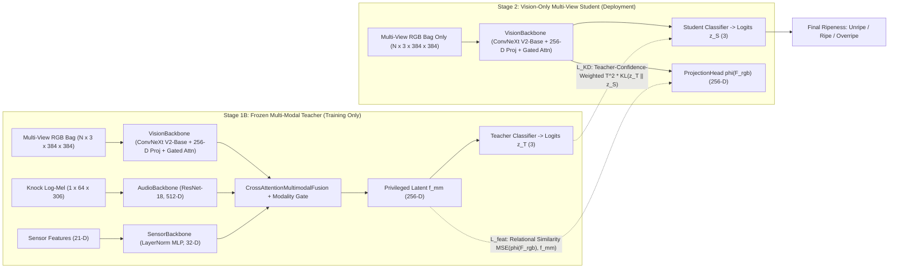

### 4.2 Component Details

1. **Multi-View Vision Backbone (`src/models/vision_backbone.py`):**
   - **Shared Extractor:** Each view $I_i$ in a fruit bag $\{I_1, \dots, I_N\}$ passes through `convnextv2_base.fcmae_ft_in1k` ($h_i \in \mathbb{R}^{1024}$) followed by a compression projection block $f_i = \text{Dropout}(\text{GELU}(\text{LayerNorm}(W_{\text{proj}} h_i))) \in \mathbb{R}^{256}$.
   - **Lightweight Gated Attention Pooling (Ilse et al., $D = 128$):** Computes normalized per-view importance weights $a_i = \text{softmax}_i\!\left(w^\top (\tanh(V f_i) \odot \sigma(U f_i))\right)$ and aggregates all views of a fruit into a unified representation $F_{\text{rgb}} = \sum_{i=1}^N a_i f_i \in \mathbb{R}^{256}$.
   - **Multi-View Regularization & TTA:** Random View Subsampling (`4–6` views/fruit/epoch) during training and per-view 3-crop/flip TTA (`0.50` original + `0.30` hflip + `0.20` 95% zoom) before pooling at evaluation time.

2. **Multi-Modal Teacher (`src/models/teacher_model.py`):**
   - **Vision Branch:** Multi-View `VisionBackbone` $\rightarrow F_{\text{rgb}} \in \mathbb{R}^{256}$.
   - **Audio Branch:** `resnet18` (`in_chans=1`) $\rightarrow f_{\text{audio}} \in \mathbb{R}^{512}$.
   - **Sensor Branch:** `Linear(21→64→48→32)` with `LayerNorm`, `ReLU`, `Dropout(0.3)` $\rightarrow f_{\text{sensor}} \in \mathbb{R}^{32}$.
   - **Cross-Attention Fusion:** Each modality is projected to `proj_dim=256`, added to learnable `modality_embed`, processed by a Pre-LN Transformer Encoder (`num_heads=4`, `dim_feedforward=512`) with `key_padding_mask` to safely ignore missing modalities, weighted by an Adaptive Modality Gate, and mapped to $f_{\text{mm}} \in \mathbb{R}^{256}$.
   - **Teacher Objective (`CostSensitiveFocalLoss`):** Focal loss ($\gamma = 2.0$, label smoothing $0.05$) combined with an **Ordinal Cost Matrix** heavily penalizing severe misclassifications (`Unripe ↔ Overripe` cost `3.0`, `Overripe → Ripe` cost `2.0`).

3. **Vision-Only Multi-View Student (`src/models/student_model.py`):**
   - **Backbone:** Same Multi-View `VisionBackbone` (`convnextv2_base.fcmae_ft_in1k` + `256-D` Projection + Gated Attention, ~88.3M parameters), initialized from the converged Stage 1A unimodal checkpoint (`best_convnextv2_multiview.pth`).
   - **Projection Head ($\phi$):** `Linear(256→512) -> LayerNorm -> GELU -> Dropout -> Linear(512→256) -> LayerNorm`, aligning $F_{\text{rgb}}$ with the Teacher's privileged multimodal space $f_{\text{mm}} \in \mathbb{R}^{256}$.
   - **Distillation Objective (`CrossModalDistillationLoss`):**
     $$\mathcal{L}_{\text{total}} = \alpha\,\mathcal{L}_{\text{CE}}(y, z_S) + \beta\,w_t\,T^2\,\mathrm{KL}\!\left(\sigma(z_T / T)\,\|\,\sigma(z_S / T)\right) + \gamma\,\mathcal{L}_{\text{rel}}\!\left(\phi(F_{\text{rgb}}), f_{\text{mm}}\right)$$
     with $\alpha = 1.0$ (label-smoothed CE, $\epsilon = 0.08$), $\beta = 0.5$ ($T = 3.0$, weighted by Teacher ground-truth confidence $w_t$), $\gamma = 0.25$ (in-batch relational cosine-similarity MSE on Teacher's fused $f_{\text{mm}}$), combined with **fruit-level deduplicated sampling** (`--dedup-fruits`) and **Feature-Space Mixup** ($\alpha_{\text{mix}} = 0.2$, $p = 0.5$).
   - **2-Phase Optimization:** Phase 1 (Epochs 1–2) freezes `VisionBackbone` to align `ProjectionHead` and `Classifier`; Phase 2 (up to 40 epochs with Early Stopping `patience=10` on held-out Val `fruit_macro_f1`) fine-tunes with differential learning rates (`lr_backbone = 2e-5`, `lr_head = 2e-4`, Cosine Annealing).

---

## 5. Installation, Pretrained Checkpoints & Quickstart

### Step 1: Clone the Repository
```bash
git clone https://github.com/Cocobaut/durian-ripeness-classification.git
cd durian-ripeness-classification
```

### Step 2: Install `uv` and Set Up the Virtual Environment
- **Windows (PowerShell):**
  ```powershell
  powershell -ExecutionPolicy ByPass -c "irm https://astral.sh/uv/install.ps1 | iex"
  uv venv venv --python 3.12
  .\venv\Scripts\Activate.ps1
  uv pip install -r requirements.txt
  ```
- **Linux / macOS:**
  ```bash
  curl -LsSf https://astral.sh/uv/install.sh | sh
  uv venv venv --python 3.12
  source venv/bin/activate
  uv pip install -r requirements.txt
  ```
*(If a `pyproject.toml`-based environment is already configured, you may also run `uv sync`.)*

### Step 3: Download Pretrained Checkpoints from Google Drive
Download the pretrained weights from the Google Drive folders below and place them in their corresponding `checkpoints/` directories:

| Model Track | Google Drive Folder | Target Local Directory | Expected Checkpoint Files |
| :--- | :--- | :--- | :--- |
| **Student Model (CMKD Stage 2)** | [Download Student Checkpoints](https://drive.google.com/drive/folders/1R8PVPQh6MQKrXFxJJSEwCgWuSaOtUJPb?usp=sharing) | `checkpoints/studentmodal/` | `best_student.pth`, `last_student.pth` |
| **Teacher Model (CMKD Stage 1B)** | [Download Teacher Checkpoints](https://drive.google.com/drive/folders/1QjpqsfAV5-Grgh4Ue9klCOJPwvCA0oiH?usp=drive_link) | `checkpoints/teachermodal/` | `best_teacher.pth`, `last_teacher.pth` |
| **Unimodal Models (Stage 1A)** | [Download Unimodal Checkpoints](https://drive.google.com/drive/folders/1bp27F7EWdfkbIB8wWMPCOUucXEJ1wohs?usp=drive_link) | `checkpoints/unimodal/` | `vision/best_convnextv2_multiview.pth`, `vision/convnextv2_multiview_backbone_256d.pth`, `audio/audio_backbone_teacher.pth`, `audio/best_audio_unimodal.pth`, `sensor/best_sensor_unimodal.pth` |

> **Tip:** To run the **Streamlit Dashboard** for inference only, downloading **`checkpoints/studentmodal/best_student.pth`** is sufficient.

### Step 4: Launch the Streamlit Dashboard
From the repository root (with `venv` activated):
```powershell
python -m streamlit run app.py
```
Then open `http://localhost:8501` in your browser to classify durian RGB images (single image or multi-view batch) into **Unripe**, **Ripe**, or **Overripe**.

---

## 6. Dataset Download & Retraining Pipeline

If you wish to re-run EDA, build the clean dataset from scratch, or retrain the Teacher and Student models, follow either Option A (download pre-built data) or Option B (reconstruct from Zenodo).

### Option A: Download Pre-Packaged Data from Google Drive
- **`data/raw/` (Original 189 Fruits):** [Google Drive — `data/raw`](https://drive.google.com/drive/folders/1gIhGj-txv1ZF_RfslbAh7bagNZdnIRhL?usp=drive_link)
- **`data/split_data/` (Sample-Level Train/Val/Test Split):** [Google Drive — `data/split_data`](https://drive.google.com/drive/folders/1ro-ETqoDNCuDwbYdZkvDuztLAF5B0XTC?usp=drive_link)
  - Train Split: [Google Drive — `split_data/train`](https://drive.google.com/drive/folders/18jp-lYZM4WorLQxH2CHGdPBjyMOYjAJG?usp=drive_link)
  - Val Split: [Google Drive — `split_data/val`](https://drive.google.com/drive/folders/11L5txIHnHls-vJzTiVNLYhlzNJMvGazp?usp=drive_link)
  - Test Split: [Google Drive — `split_data/test`](https://drive.google.com/drive/folders/1GBJ9aoDJ_ZmgnHg2inM8RtAjRS3-wKZ0?usp=drive_link)
- **`data/final/` (Cleaned & Standardized CMKD Dataset):** [Google Drive — `data/final`](https://drive.google.com/drive/folders/1uiDts7iwxn7tMov9yzjnNzMTQCEBjT_Q?usp=drive_link)

### Option B: Reconstruct & Build `data/final/` from Scratch (Google Colab / Local)
1. **Download from Zenodo & Perform Stratified Split:**
   Open and run [`data/download_and_split_data_to_drive.ipynb`](data/download_and_split_data_to_drive.ipynb) on Google Colab (`Runtime -> Run all`). It fetches the dataset directly from Zenodo Record `18603796`, unpacks all modalities into Google Drive (`/content/drive/MyDrive/durian-ripeness-cmkd/data/raw`), removes intermediate `.zip` archives, and executes the zero-leakage sample-level split into `data/split_data/{train,val,test}` along with `sample_split_mapping.csv`.
2. **Audit Cross-Modal Alignment (Optional Verification):**
   Run [`workspaces/member1_vision_lead/03_create_final_dataset/01_multimodal_eda_and_data_audit.ipynb`](workspaces/member1_vision_lead/03_create_final_dataset/01_multimodal_eda_and_data_audit.ipynb) to verify `Code <-> fruit_id` resolution and generate the multimodal completeness matrix.
3. **Build the Final Standardized Dataset (`data/final/`):**
   Run [`workspaces/member1_vision_lead/03_create_final_dataset/02_build_final_dataset.ipynb`](workspaces/member1_vision_lead/03_create_final_dataset/02_build_final_dataset.ipynb). This applies:
   - Train-only median imputation, Q0.01–Q0.99 clipping, and `StandardScaler` (`sensor_preprocessor.joblib`).
   - RGB resizing (512px) and LAB L-channel CLAHE standardization.
   - Audio 48 kHz clean filtering, MD5 deduplication, and session mismatch removal.
   - Thermal/Multispectral standardized naming and **Master Manifest** creation (`data/final/final_multimodal_manifest.csv`) with zero-masking flags.

### Retraining & Evaluation CLI Commands
Run from the repository root:

```bash
# 1. Smoke test Teacher & Student pipelines
python train_teacher.py --smoke
python train_student.py --smoke

# 2. Train Unimodal Acoustic Baseline
python workspaces/member2_audio/02_train_unimodal_audio/train_audio.py

# 3. Train Unimodal Sensor Baseline (MLP + RandomForest across 6 feature sets)
python workspaces/member3_sensor/02_train_unimodal_sensor/train_unimodal_sensor.py

# 4. Train Stage 1B Multi-Modal Teacher (and evaluate on Test set)
python train_teacher.py --epochs 30 --batch-size 4 --accum-steps 2 --eval-test --device cuda

# 5. Distill Stage 2 Vision-Only Multi-View Student (and evaluate + generate benchmark comparison)
python train_student.py --student-backbone convnextv2_base --dedup-fruits --loss-type ce \
    --alpha 1.0 --beta 0.5 --gamma 0.25 --temperature 3.0 \
    --feat-target fused --feat-loss-type relational --kd-weighting teacher_confidence \
    --mixup-alpha 0.2 --epochs 40 --warmup-epochs 2 --patience 10 --batch-size 4 --accum-steps 2 \
    --eval-test --device cuda

# 6. Evaluate an existing Student checkpoint independently (RGB-only)
python workspaces/member1_vision_lead/04_train_teacher_and_student/eval_student.py \
    --checkpoint checkpoints/studentmodal/best_student.pth \
    --split test
```

### Training on Google Colab (Interactive GPU Notebooks)

If you do not have a local NVIDIA GPU, you can reproduce Stage 1B Teacher training and Stage 2 Student CMKD distillation directly on **Google Colab** (tested on **NVIDIA L4 / T4** GPUs) using the pre-configured notebooks:

1. **Stage 1B — Train the Multi-Modal Teacher:**
   Open [`workspaces/member1_vision_lead/04_train_teacher_and_student/01_train_multimodal_teacher.ipynb`](workspaces/member1_vision_lead/04_train_teacher_and_student/01_train_multimodal_teacher.ipynb) in Google Colab (`Runtime -> Change runtime type -> GPU`).
   - **What it does automatically:**
     1. Mounts Google Drive and verifies CUDA GPU availability (`!nvidia-smi`).
     2. Clones/pulls the repository from GitHub (`BRANCH = ""` targets the repository's default branch automatically; optionally set a branch name if testing a feature branch).
     3. Installs all dependencies rapidly via `uv pip install --system -r requirements.txt`.
     4. Symlinks `data/final/`, `checkpoints/unimodal/`, `checkpoints/teachermodal/`, and training outputs directly to `/content/drive/MyDrive/durian-ripeness-cmkd/` so weights and metrics persist safely across Colab disconnects.
     5. Runs `train_teacher.py` (`--fusion-type cross_attention`, `--loss-type cost_sensitive_focal`, `--epochs 30`, `--warmup-epochs 5`, `--eval-test`) followed by standalone cross-modal & ablation evaluation via `python -m src.evaluators.eval_teacher`.

2. **Stage 2 — Distill the Vision-Only Student (CMKD):**
   Once `best_teacher.pth` is saved (or downloaded into `checkpoints/teachermodal/` on Drive), open [`workspaces/member1_vision_lead/04_train_teacher_and_student/02_train_vision_student.ipynb`](workspaces/member1_vision_lead/04_train_teacher_and_student/02_train_vision_student.ipynb) in Google Colab.
   - **What it does automatically:**
     1. Mounts Google Drive, clones/syncs the latest codebase (`BRANCH = ""`), and installs dependencies via `uv`.
     2. Symlinks `data/final/`, `checkpoints/teachermodal/best_teacher.pth`, `checkpoints/studentmodal/`, and `results_student/` to Google Drive.
     3. Runs two-phase CMKD distillation (`train_student.py` with Multi-View `convnextv2_base`, `--dedup-fruits`, `CE`, `alpha=1.0`, `beta=0.5`, `gamma=0.25`, `T=3.0`, relational `fused` feature alignment, `teacher_confidence` KD weighting, Feature-Space Mixup, `--epochs 40`, `--warmup-epochs 2`, `--patience 10`, `--eval-test`).
     4. Runs standalone RGB-only evaluation via `eval_student.py` and generates `benchmark_comparison.md` comparing Unimodal baselines, Teacher, and Student.

> **Google Drive Folder Layout Expected by Both Colab Notebooks:**
> Place your dataset and pretrained unimodal/teacher weights under `/content/drive/MyDrive/durian-ripeness-cmkd/`:
> ```text
> MyDrive/durian-ripeness-cmkd/
> ├── data/final/
> │   ├── final_multimodal_manifest.csv
> │   ├── train/
> │   ├── valid/
> │   └── test/
> └── checkpoints/
>     ├── unimodal/{vision,audio,sensor}/
>     ├── teachermodal/   (populated by 01_train_multimodal_teacher.ipynb)
>     └── studentmodal/   (populated by 02_train_vision_student.ipynb)
> ```

---

## 7. Running the Interactive Streamlit Dashboard (Step-by-Step Guide)

Follow these steps to run local real-time durian ripeness inference using the Vision-Only Student model (`app.py` + `visualization/`):

1. **Activate Your Python Virtual Environment** (from the repository root):
   - **Windows (PowerShell):**
     ```powershell
     .\venv\Scripts\Activate.ps1
     ```
   - **Linux / macOS:**
     ```bash
     source venv/bin/activate
     ```

2. **Verify Student Weights Exist Locally:**
   Ensure `checkpoints/studentmodal/best_student.pth` is present (or have a custom `.pth` checkpoint ready to upload in the sidebar).

3. **Start the Streamlit Server:**
   ```bash
   python -m streamlit run app.py
   ```
   Open the local URL printed in the terminal (default: `http://localhost:8501`) in any modern browser.

4. **Configure Model & Run Inference in the Web UI:**
   - **Sidebar (`Student Model Settings`):** Choose `Best Student (best_student.pth)`, `Last Student (last_student.pth)`, or upload a custom `.pth` checkpoint, and select `CUDA` (if available) or `CPU`.
   - **Mode 1 — `Single Image Prediction`:**
     - Select **Upload Image File** (supports `.jpg`, `.jpeg`, `.png`, `.webp`, `.bmp`) or **Camera Capture** to upload/snap one durian RGB photo.
     - Review the centered RGB preview and click **`Run Ripeness Prediction`** directly below the image.
     - Inspect the predicted ripeness verdict (**`Unripe`**, **`Ripe`**, or **`Overripe`**), confidence score, post-harvest recommendation, latency (`ms`), and probability bar chart.
   - **Mode 2 — `Multi-View Fruit Prediction (Multiple Angles)`:**
     - Upload multiple camera angles of the same fruit (e.g., `TOP`, `BOT`, `SA`, `SB`, `SC`, `SD`) or capture sequential views via camera.
     - Choose the fruit-level aggregation rule: **`Mean Probability (Recommended)`** or **`Majority Vote`**.
     - Click **`Run Ripeness Prediction`** to obtain the aggregated fruit-level verdict, angle consistency percentage, interactive per-angle breakdown bar chart, and downloadable CSV results.

---

## 8. Exploratory Data Analysis (EDA) Report

### 8.1 Vision Track EDA & Preprocessing (`member1_vision_lead`)
*Artifacts stored in [`workspaces/member1_vision_lead/01_eda_and_preprocess_vision/results/`](workspaces/member1_vision_lead/01_eda_and_preprocess_vision/results/).*

- **Balanced Classes & Zero-Leakage Split:** 189 fruits are strictly balanced (**63 Unripe / 63 Ripe / 63 Overripe**, 33.3% each) and partitioned at the fruit level into **132 Train (44/44/44)**, **28 Val (9/9/10)**, and **29 Test (10/10/9)**.
- **Physicochemical Grounding:** Median pulp firmness (`Firmness_AVE`) drops **14.7×** from `7.22 kgf/cm²` (`Unripe`) to `0.49 kgf/cm²` (`Ripe`) and `0.43 kgf/cm²` (`Overripe`), while median sweetness (`TSS_AVE`) surges from `4.67 °Brix` (`Unripe`) to `8.27 °Brix` (`Ripe`) and `7.88 °Brix` (`Overripe`).
- **Image Quality & Coverage:** All 2,718 raw RGB images have uniform $6000 \times 4000$ (3:2) resolution with **0 corrupted files**, high sharpness (mean Laplacian variance ~274, 0 blurry images below threshold 50), and consistent illumination. In `data/final`, **172 / 189 fruits** (`2,077` images) have standardized RGB captures across the 6 camera angles (`TOP`, `BOT`, `SA`, `SB`, `SC`, `SD`).
- **L-Channel CLAHE Validation:** Applying CLAHE (`clip_limit=2.0`, `tile_grid_size=(8, 8)`) strictly on the CIE **LAB `L` channel** boosts lightness contrast (`L` std increases from `39.69` to `53.78`, **+35.5%**) to sharpen spine grooves while keeping peel color intact (mean `A/B` chrominance shift is only `0.55` on a 0–255 scale).

<p align="center">
  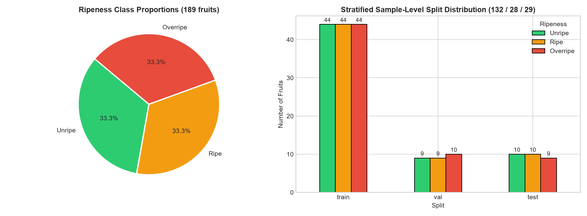
  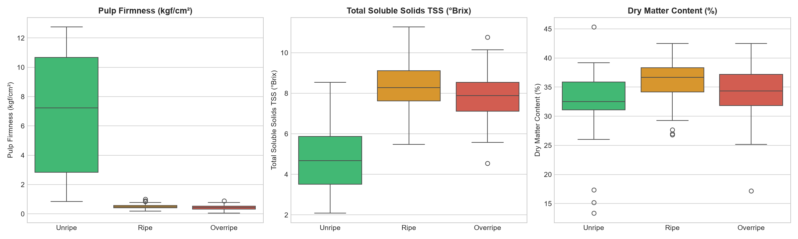
</p>
<p align="center">
  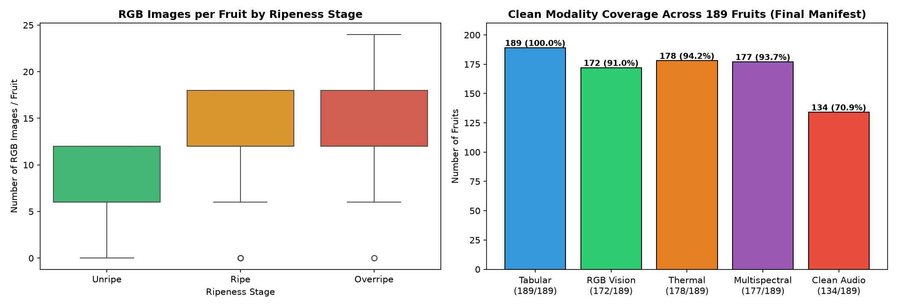
</p>
<p align="center">
  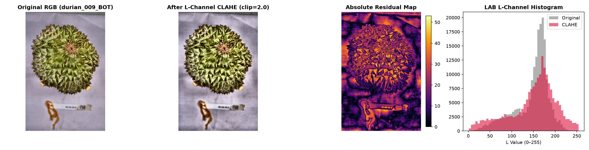
</p>
<p align="center">
  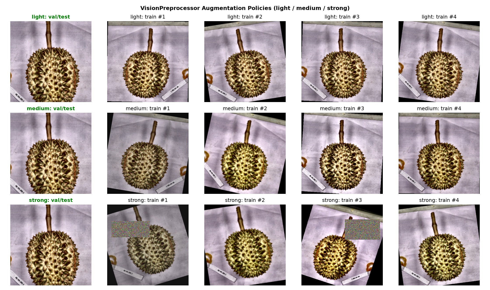
  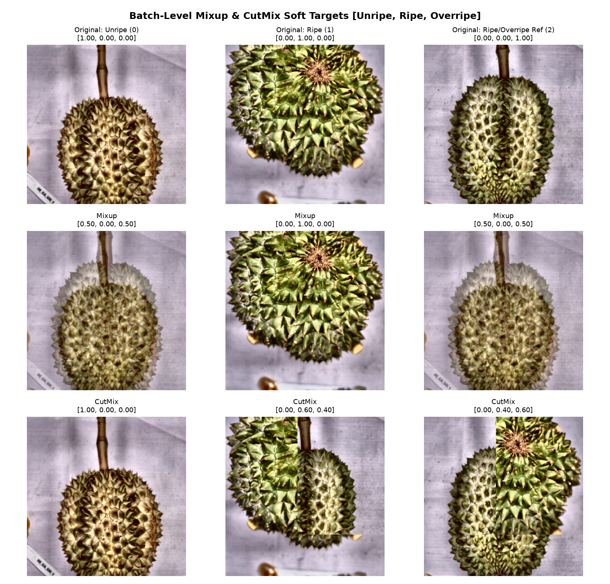
</p>

---

### 8.2 Acoustic Knock Sound Track EDA (`member2_audio`)
*Artifacts stored in [`workspaces/member2_audio/01_eda_and_preprocess_audio/results/`](workspaces/member2_audio/01_eda_and_preprocess_audio/results/).*

- **Metadata & File Integrity Audit:** Out of **562** raw recordings (281 iPhone `.m4a` + 281 Android `.wav` across 175/189 fruits), metadata cross-referencing uncovered an ~8-hour Android timestamp offset (`167/281` pairs) and **109 suspicious files** (106 MD5-identical Android duplicates overwritten across sessions + temporal label mismatches where only **47.7%** of raw filenames matched final harvest ripeness). Filtering removed the 109 corrupted/duplicate files, leaving **453 clean recordings** (and **134/189 fruits** with ground-truth label-matched audio).
- **Spectral & Knock Structure Analysis:** Across all recordings, **99.60% of acoustic energy lies below 8 kHz**, validating downsampling from 48 kHz to **16 kHz** (`Nyquist = 8 kHz`). As ripeness progresses, dominant resonance shifts downward (`Unripe` ~750 Hz $\to$ `Ripe`/`Overripe` ~400 Hz) due to internal flesh-husk detachment. `AudioPreprocessor` extracts **$K = 6$ knocks × $0.5\text{ s}$** into normalized **`[1, 64, 306]`** log-Mel spectrograms.
- **Recording Session Leakage Discovery & Mitigation:** Probing pure background silence segments revealed severe session leakage (**Macro-F1 = 0.605** vs. permutation chance **0.278**, $p = 0.005$). Applying **Spectral Gating (`noisereduce`) + Knock Envelope Gating** suppressed background leakage down to **0.294** (virtually indistinguishable from random chance):

| Leakage Audit Condition | Background-Only Macro-F1 | Leakage Status |
| :--- | :---: | :--- |
| Raw Unprocessed Audio | `0.605 ± 0.041` | Severe session leakage ($p < 0.005$) |
| After Spectral Gating (`noisereduce`) | `0.342 ± 0.028` | Reduced by 43.5% |
| **After Spectral Gating + Knock Envelope Gating** | **`0.294 ± 0.021`** | **Eliminated (near random chance)** |
| Theoretical Permutation Chance Baseline | `0.278 ± 0.019` | Reference floor |

- **Acoustic Backbone Selection (3-Seed 5-Fold CV, 389 clean files):** `ResNet-18 (from scratch)` outperformed pretrained `ResNet-18`, `EfficientNet-B0`, `PANNs CNN10`, and MFCC baselines (`SVM`, `Random Forest`) and generalizes cleanly across iPhone (`0.810` F1) and Android (`0.847` F1) devices:

| Model | Params | Accuracy (Mean ± Std) | Macro-F1 (Mean ± Std) | F1 (`Unripe` / `Ripe` / `Overripe`) |
| :--- | :---: | :---: | :---: | :---: |
| **`resnet18_scratch`** | 11.17M | **87.49% ± 1.65%** | **82.43% ± 1.81%** | **95.05% / 79.10% / 73.16%** |
| `resnet18_pretrained` | 11.17M | 86.12% ± 2.45% | 81.28% ± 2.56% | 94.17% / 76.58% / 73.09% |
| `efficientnet_b0_pretrained` | 4.01M | 86.80% ± 1.32% | 81.16% ± 1.21% | 95.25% / 77.29% / 70.94% |
| `panns_cnn10_pretrained` | 4.95M | 85.26% ± 1.32% | 80.00% ± 2.02% | 94.24% / 74.85% / 70.90% |
| `mfcc_svm` | — | 83.55% ± 0.26% | 77.58% ± 0.52% | 92.58% / 72.98% / 67.17% |
| `mfcc_rf` | — | 84.06% ± 0.68% | 76.74% ± 0.88% | 93.70% / 74.20% / 62.31% |

<p align="center">
  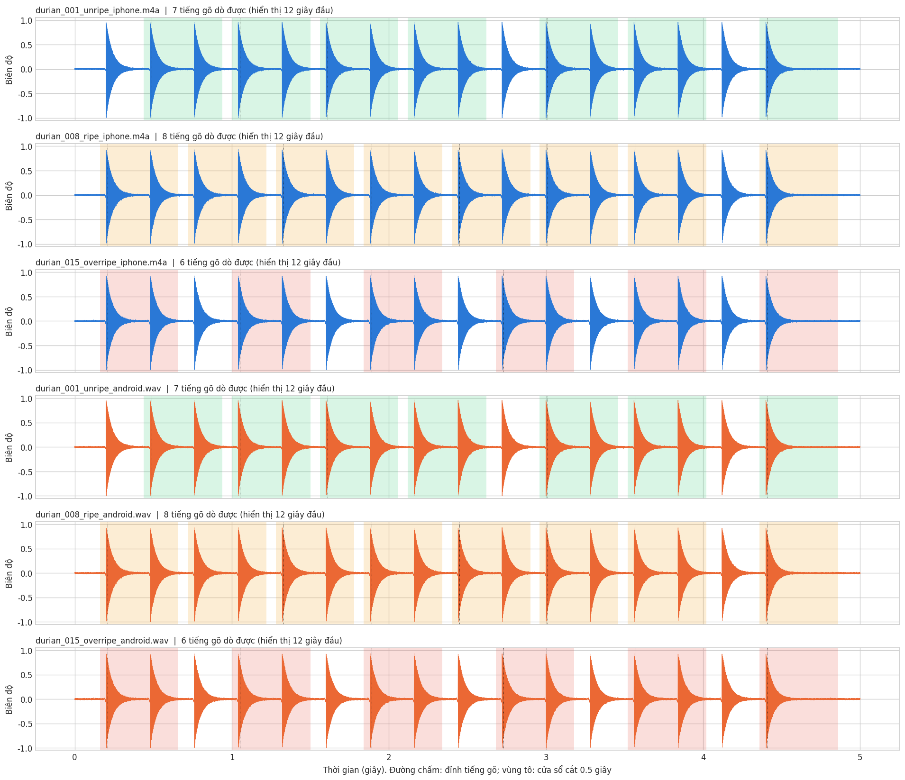
  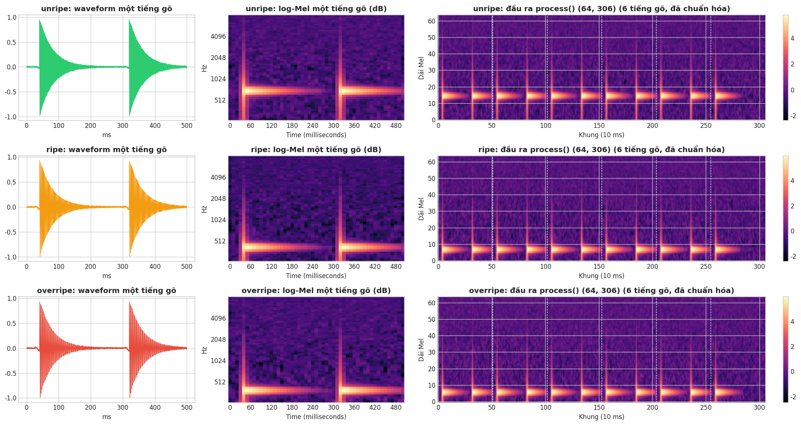
</p>
<p align="center">
  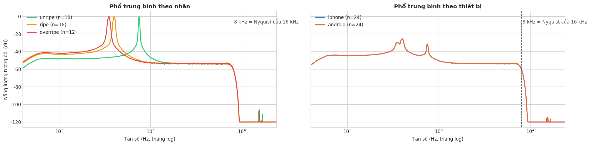
  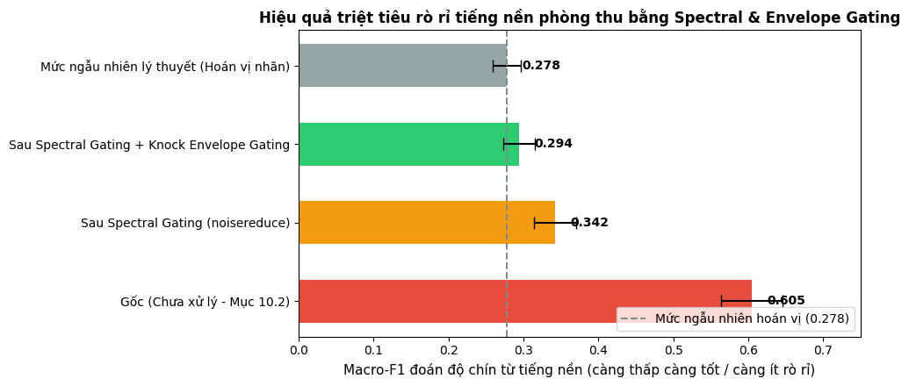
</p>
<p align="center">
  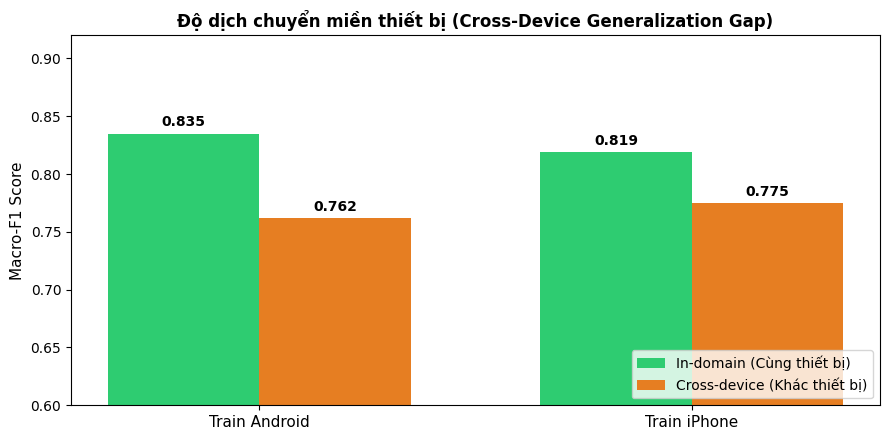
</p>

---

### 8.3 Sensor Track EDA: Tabular, Thermal & Multispectral (`member3_sensor`)
*Artifacts stored in [`workspaces/member3_sensor/01_eda_and_preprocess_sensor/results/figures/`](workspaces/member3_sensor/01_eda_and_preprocess_sensor/results/figures/).*

- **Tabular Physicochemical Correlations:** Among the 8 non-leakage attributes, `Firmness_AVE` exhibits the strongest inverse correlation with ripeness (Spearman $\rho = -0.78$, log-transformed Pearson $r = -0.79$), followed by `TSS_AVE` (Pearson $r = +0.62$, Spearman $\rho = +0.58$). 5-fold permutation importance confirms `Firmness_AVE`, `Dry_Matter_AVE`, and `TSS_AVE` as top predictors.
- **Thermal Otsu Foreground Segmentation:** `extract_thermal_features()` uses centroid-aware Otsu thresholding on $1024 \times 1024$ thermal matrices (e.g., `durian_002` threshold `81.90 °C`, mean foreground `80.54 °C` vs. background `83.72 °C`) to derive ambient-compensated temperature differentials (`delta_temp_fg_bg`).
- **Multispectral 8-Band NIR Signatures:** `unpack_multispectral_grid()` decomposes each $512 \times 1024$ GeoTIFF montage into 8 co-registered `256×256` spectral bands and applies a 15th-percentile foreground filter to extract 8 reflectance intensities (`band_1_mean`..`band_8_mean`).
- **Integrated Feature Set (`C_integrated19`):** Combining 8 tabular features + 3 thermal features + 8 multispectral features + 2 binary availability masks (`mask_thermal`, `mask_multispectral`) produces the **21-D** input vector for `SensorBackbone`.

<p align="center">
  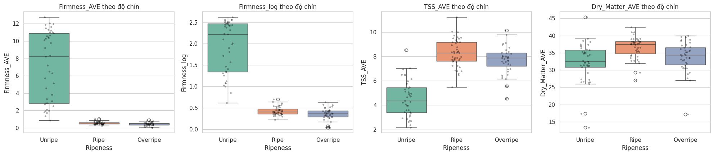
  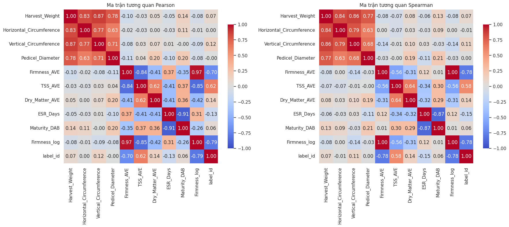
</p>
<p align="center">
  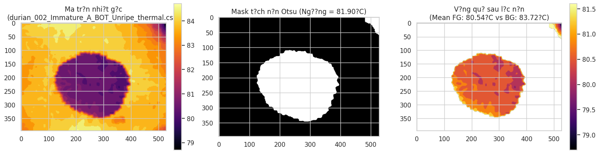
  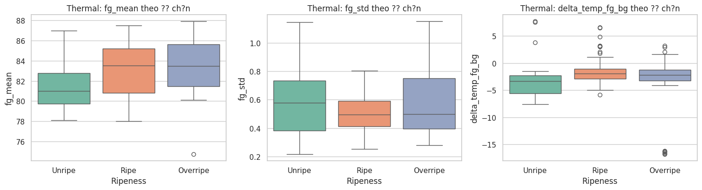
</p>
<p align="center">
  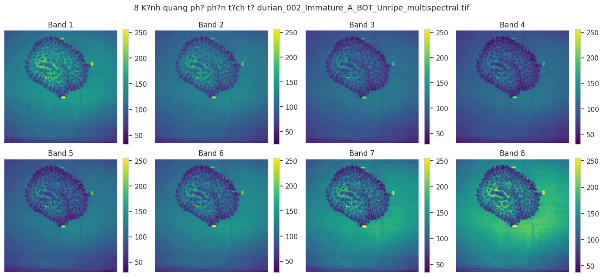
  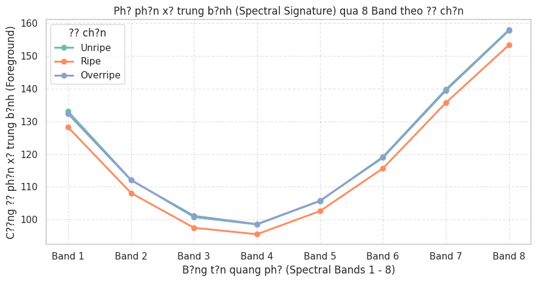
</p>
<p align="center">
  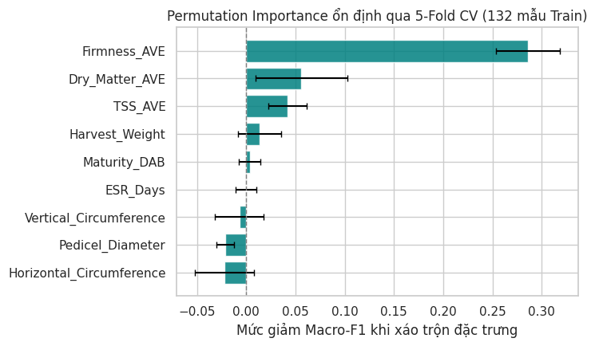
  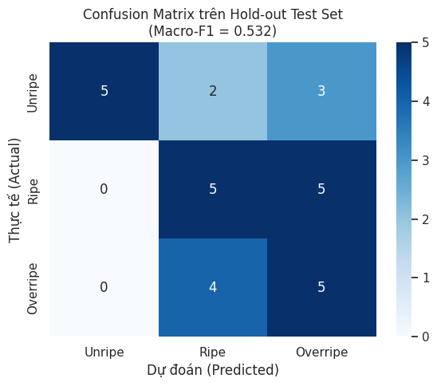
</p>

---

### 8.4 Multimodal Alignment & Data Audit Summary
- **Code ID Recovery:** Resolving alternate `Code` identifiers (`A10B8-C2`, etc.) via `sample_split_mapping.csv` recovered **556 RGB images** (~20% of the raw RGB gallery) that naive regexes would have dropped.
- **Final Modality Availability across 189 Fruits (`final_multimodal_manifest.csv`):**
  - Tabular Features: **189 / 189 (100.0%)**
  - Thermal Features: **178 / 189 (94.2%)**
  - Multispectral Features: **177 / 189 (93.7%)**
  - RGB Vision Images: **172 / 189 (91.0%)**
  - Clean Label-Matched Audio: **134 / 189 (70.9%)** *(remaining 55 fruits receive `has_audio = False` and zero-masking in the Teacher's cross-attention fusion)*

---

## 9. Experimental Results (Vision Baselines, Unimodal, Teacher & Student)

### 9.1 Vision Architecture Benchmark: Single-View (`outputs/`) vs. Multi-View Gated Attention (`outputs_improve/`)

Before training the Multi-Modal Teacher, we systematically benchmarked three vision backbones (`ResNet-50`, `DINOv3 ViT-B/16`, and `ConvNeXt V2-Base`) on the same **24 hold-out test fruits (`298` RGB images)** under two input paradigms:
- **Single-View (`outputs/`):** Each RGB image is classified independently and aggregated at the fruit level via mean-probability voting.
- **Multi-View Gated Attention (`outputs_improve/` & `02_train_unimodal_vision/results/`):** All viewpoints of the same fruit are grouped into a Multi-View Bag, compressed via `backbone_dim → 256`, and pooled via **Lightweight Gated Attention (Ilse et al., $D = 128$)** with 3-view TTA.

| Vision Backbone | Paradigm / Source | Image-Level Acc | Image-Level Macro-F1 | Fruit-Level Acc | Fruit-Level Macro-F1 | Fruit Gain vs. Single-View |
| :--- | :--- | :---: | :---: | :---: | :---: | :---: |
| **ResNet-50** (`resnet50.a1_in1k`) | Single-View (`baselines/ResNet-50/outputs`) | `31.54%` | `28.28%` | `33.33%` | `30.10%` | — |
| **ResNet-50** + 256-D Proj + Gated Attn | Multi-View (`baselines/ResNet-50/outputs_improve`) | `36.58%` | `36.25%` | `41.67%` | `42.04%` | **+8.34% Acc / +11.94% F1** |
| **DINOv3** (`vit_base_patch16_dinov3`) | Single-View (`baselines/DINOv3_classification_head/outputs`) | `38.59%` | `38.77%` | `45.83%` | `44.75%` | — |
| **DINOv3** + 256-D Proj + Gated Attn | Multi-View (`baselines/DINOv3_classification_head/outputs_improve`) | `29.19%` | `27.53%` | `50.00%` | `49.48%` | **+4.17% Acc / +4.73% F1** |
| **ConvNeXt V2-Base** (`fcmae_ft_in1k`) | Single-View (`baselines/ConvNeXtV2/outputs`) | `40.60%` | `41.00%` | `45.83%` | `43.51%` | — |
| **ConvNeXt V2-Base** + 256-D Proj + Gated Attn *(Official)* | **Multi-View (`02_train_unimodal_vision/results`)** | `38.26%` | `38.05%` | **`58.33%`** | **`55.59%`** | **+12.50% Acc / +12.08% F1** |

> **Key Vision Architectural Takeaway:** Grouping all viewpoints of a fruit with `1024 → 256` compression and Lightweight Gated Attention consistently boosts fruit-level grading across **every** tested architecture (`+4.17%` to `+12.50%` Fruit Accuracy). **Multi-View `ConvNeXt V2-Base`** achieves the strongest visual performance (**58.33% Fruit Acc / 55.59% Fruit Macro-F1**, `Unripe F1 = 77.78%`, `Ripe F1 = 52.63%`, `Overripe F1 = 36.36%`, `test_bag_loss = 1.2071`) and is adopted as the official Vision backbone for both Teacher and Student.

### 9.2 Stage 1A — Unimodal Baselines Summary

1. **Vision Unimodal Baseline (Multi-View `ConvNeXt V2-Base` + Gated Attention, RGB Only):**
   - Evaluated on `298` test RGB images grouped into `24` fruit bags (`workspaces/member1_vision_lead/02_train_unimodal_vision/results/`).
   - Achieves **38.26% Single-View Acc / 38.05% Single-View Macro-F1** and **58.33% Fruit Accuracy / 55.59% Fruit Macro-F1** (`14/24` fruits; `Unripe` recall `87.5%`, `Ripe` recall `62.5%`, `Overripe` recall `25.0%`), highlighting the visual ambiguity between `Ripe` and `Overripe` peels.

2. **Acoustic Unimodal Baseline (`ResNet-18` Scratch, Knock Audio Only):**
   - Evaluated on `38` clean test audio files across `20` fruits (`workspaces/member2_audio/02_train_unimodal_audio/results/`).
   - Achieves **84.21% Sample Accuracy / 81.37% Sample Macro-F1** and **95.00% Fruit Accuracy / 93.73% Fruit Macro-F1** (`1.00` F1 on `Unripe`, `0.923` on `Ripe`, `0.889` on `Overripe`, Fruit ROC-AUC `0.9477`).

3. **Sensor Unimodal Baseline (`Integrated MLP`, 21-D `C_integrated19`):**
   - Evaluated across all `29` test fruits (`workspaces/member3_sensor/02_train_unimodal_sensor/results/`).
   - Selected official checkpoint (`seed=43`, `C_integrated19`) reaches **78.57% Val Accuracy (0.7815 Macro-F1)** and **68.97% Test Accuracy (67.91% Macro-F1, 0.8317 ROC-AUC)**. Multi-seed feature-set ablation results:

| Feature Set | Model | Features | Val Acc | Val Macro-F1 | Test Acc | Test Macro-F1 |
| :--- | :--- | :---: | :---: | :---: | :---: | :---: |
| **`B_with_lab`** | MLP (3 seeds) | 20 | `78.6% ± 2.9%` | `78.7% ± 3.1%` | `72.4% ± 2.8%` | `71.4% ± 2.6%` |
| **`C_integrated19` (Official)** | MLP (3 seeds) | 21 | `73.8% ± 4.5%` | `73.6% ± 4.2%` | `71.3% ± 3.3%` | `69.0% ± 3.9%` |
| `T_tabular8` | MLP (3 seeds) | 8 | `77.4% ± 1.7%` | `77.6% ± 1.8%` | `59.8% ± 1.6%` | `59.7% ± 2.0%` |
| `M_multispectral_only` | RandomForest (500 trees) | 9 | `32.1%` | `31.1%` | `51.7%` | `50.0%` |
| `A_nondestructive` | RandomForest (500 trees) | 17 | `53.6%` | `51.7%` | `44.8%` | `44.3%` |
| `H_thermal_only` | RandomForest (500 trees) | 4 | `46.4%` | `45.2%` | `41.4%` | `40.3%` |

<p align="center">
  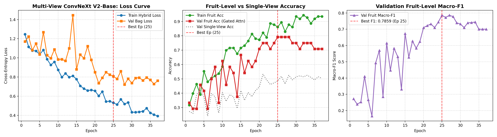
  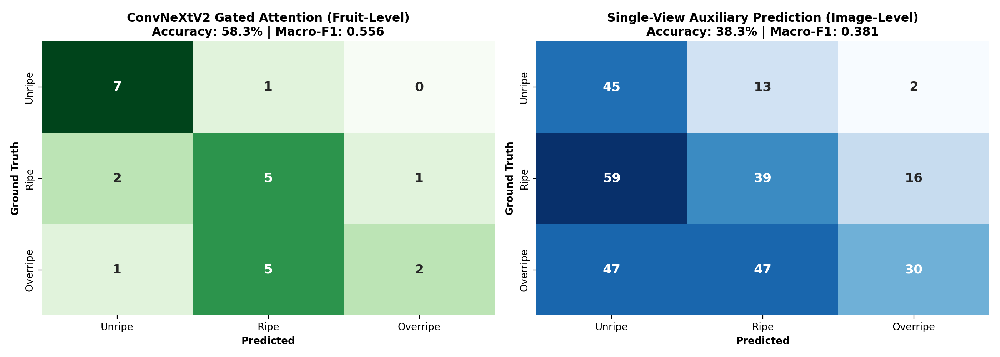
</p>
<p align="center">
  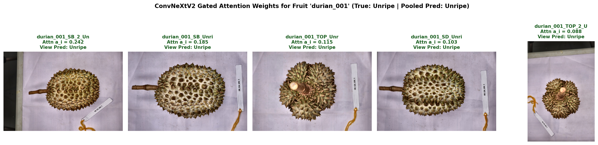
</p>
<p align="center">
  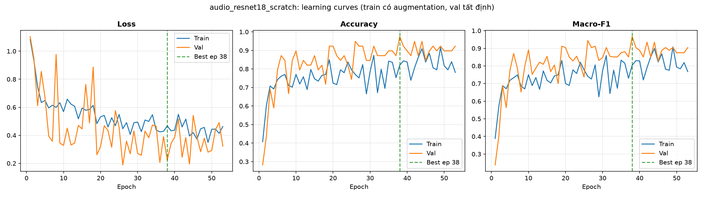
  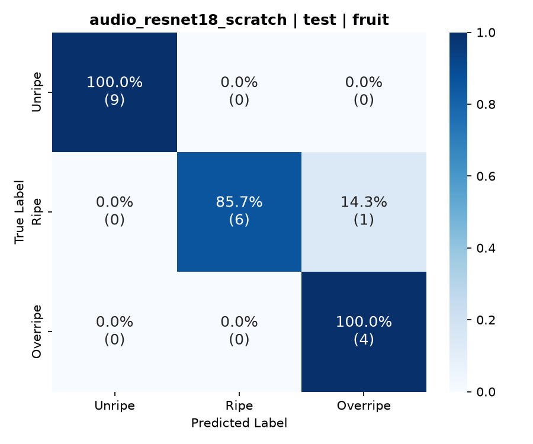
  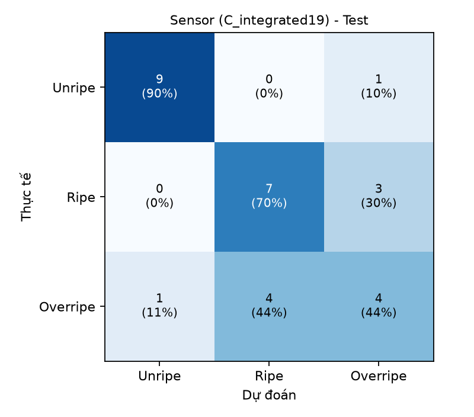
</p>

---

### 9.3 Stage 1B — Multi-Modal Teacher (`MultiModalTeacher`)
*Results stored in [`workspaces/member1_vision_lead/04_train_teacher_and_student/results_teacher/`](workspaces/member1_vision_lead/04_train_teacher_and_student/results_teacher/).*

- **Validation Performance (`45` multimodal samples / `28` fruits):** `95.56%` Sample Accuracy (`95.14%` Sample Macro-F1), **`92.86%` Fruit Accuracy (`92.96%` Fruit Macro-F1)**, **`0.9718` Fruit ROC-AUC**.
- **Hold-Out Test Performance (`47` multimodal samples / `29` fruits):** `80.85%` Sample Accuracy (`78.21%` Sample Macro-F1), **`79.31%` Fruit Accuracy (`78.41%` Fruit Macro-F1)**, and **`0.9006` Fruit ROC-AUC** (`100%` F1 on `Unripe` fruits). Restricted to the **same `24` RGB fruits** evaluated by the Student, the Teacher achieves **`79.17%` Fruit Accuracy / `79.08%` Fruit Macro-F1**.
- **Modality Ablation Study (`test_ablation.csv`):** Upgrading the Vision branch to Multi-View Gated Attention makes **every** modality contribute positively to the Teacher—masking any single branch degrades both Sample and Fruit Macro-F1 (`-13.05%` without Sensor, `-9.93%` without Audio, `-6.63%` without Multi-View Vision):

| Ablation Setting | Sample Acc | Sample Macro-F1 | $\Delta$ Sample Macro-F1 | Fruit Acc | Fruit Macro-F1 | $\Delta$ Fruit Macro-F1 | Fruit ROC-AUC |
| :--- | :---: | :---: | :---: | :---: | :---: | :---: | :---: |
| **`full` (Multi-View RGB + Audio + Sensor)** | **`80.85%`** | **`78.21%`** | `0.00%` | **`79.31%`** | **`78.41%`** | `0.00%` | **`0.9006`** |
| `wo_audio` (Zero-mask Audio) | `68.09%` | `64.03%` | `-14.18%` | `68.97%` | `68.48%` | `-9.93%` | `0.8471` |
| `wo_sensor` (Zero-mask Sensor) | `70.21%` | `68.36%` | `-9.86%` | `65.52%` | `65.36%` | `-13.05%` | `0.8737` |
| `wo_vision` (Zero-mask RGB) | `78.72%` | `72.51%` | `-5.71%` | `75.86%` | `71.77%` | `-6.63%` | `0.8765` |

<p align="center">
  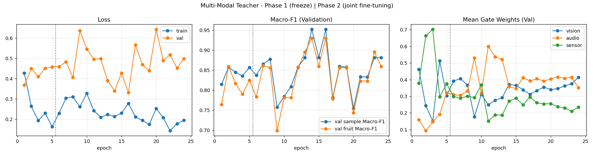
  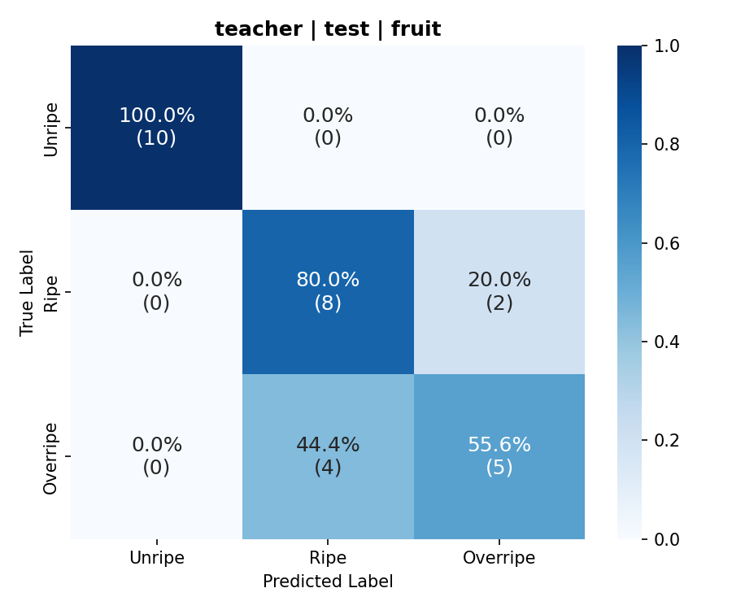
</p>

---

### 9.4 Stage 2 — Vision-Only Multi-View Student (`VisionStudent` CMKD) & Master Benchmark
*Results stored in [`workspaces/member1_vision_lead/04_train_teacher_and_student/results_student/`](workspaces/member1_vision_lead/04_train_teacher_and_student/results_student/).*

- **Validation (`24` RGB fruit bags):** **`79.17%` Fruit Accuracy (`78.59%` Fruit Macro-F1)**, `0.8522` ROC-AUC, and **`0.6968` Log-Loss** (improving calibration over Unimodal Vision's `0.8066` Val Loss).
- **Hold-Out Test (`24` RGB fruit bags):** **`54.17%` Fruit Accuracy (`51.85%` Fruit Macro-F1)** (`13/24` fruits, `77.78%` Unripe F1, `44.44%` Ripe F1, `33.33%` Overripe F1), `0.7370` Fruit ROC-AUC, and **`1.0839` Log-Loss** (improving probability calibration over Unimodal Vision's `1.2071` Test Loss).

#### Master Benchmark Comparison (Test Set — `benchmark_comparison.md`)

| Model | Test Input | Sample Acc | Sample Macro-F1 | Fruit Acc | Fruit Macro-F1 |
| :--- | :--- | :---: | :---: | :---: | :---: |
| **1. Vision Unimodal (`ConvNeXt V2-Base` Multi-View)** | Multi-View RGB | `38.26%` | `38.05%` | `58.33%` | `55.59%` |
| **2. Sensor Unimodal (`Integrated MLP`)** | Sensor (19 fts) | `68.97%` | `67.91%` | `68.97%` | `67.91%` |
| **3. Audio Unimodal (`ResNet-18`, 20 fruits)** | Audio Only | `84.21%` | `81.37%` | `95.00%` | `93.73%` |
| **4. Multi-Modal Teacher (`Cross-Attention`)** | Multi-View RGB + Audio + Sensor | `80.85%` | `78.21%` | `79.31%` | `78.41%` |
| **4b. Multi-Modal Teacher (same 24 RGB fruits as Student)** | Multi-View RGB + Audio + Sensor | — | — | `79.17%` | `79.08%` |
| **5. Vision-Only Student (`ConvNeXt V2-Base` CMKD Multi-View)** | **Multi-View RGB Only** | **`54.17%`** | **`51.85%`** | **`54.17%`** | **`51.85%`** |

> **Key Findings & Physical Limitation Analysis:**
> - **Multi-Modal Upper Bound Confirmed:** Upgrading to Multi-View RGB boosts the Multi-Modal Teacher from `72.41%` to **`79.31%` Fruit Accuracy** (`+20.84%` Acc / `+23.49%` Macro-F1 over Multi-View Vision Unimodal on the same 24 RGB fruits).
> - **Probability Calibration Gain in Student:** Teacher soft-logit distillation improves probability calibration on both Validation (`0.8066 → 0.6968` Log-Loss) and Hold-Out Test (`1.2071 → 1.0839` Log-Loss), while retaining `Unripe F1 = 77.78%` and differing from Unimodal Vision by only **1 boundary fruit (`durian_119`, `13/24` vs. `14/24`)** where the Teacher itself mispredicted `Overripe` (`0.782`).
> - **Cross-Modal Information Asymmetry (Physical Limitation):** Across `5/8` `Overripe` test fruits (`durian_057`, `063`, `078`, `080`, `123`), external peel morphology is visually indistinguishable from `Ripe` (both Unimodal Vision and Student predict `Ripe` with `0.55–0.86` probability), whereas the Teacher separates them using **internal** acoustic resonance (`95.0%`) and physicochemical readings (`68.97%`). Pushing aggressive backbone updates under unrecoverable cross-modal supervision on `124` training fruits induces **Negative Cross-Modal Transfer**, demonstrating a genuine physical ceiling for RGB-only durian grading and motivating future **RGB + Smartphone Audio** deployment.

<p align="center">
  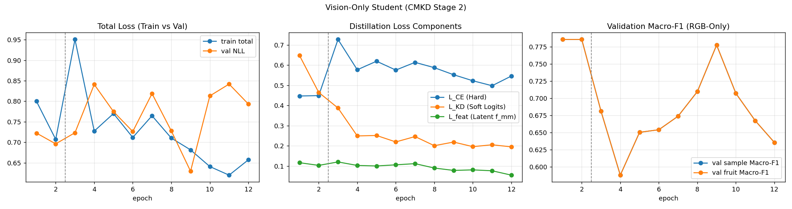
  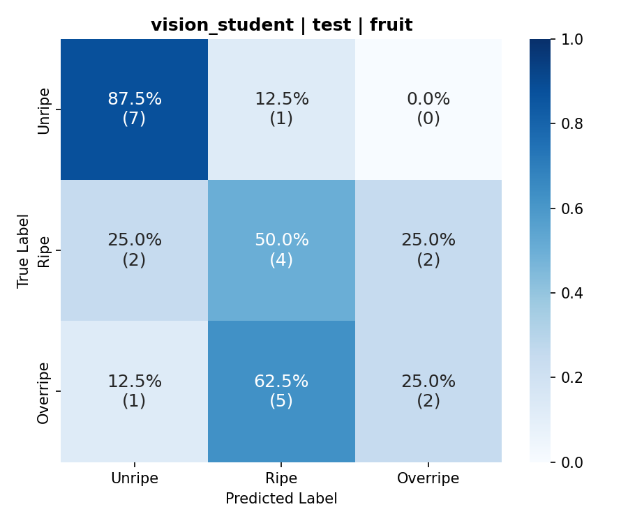
</p>

---

## 10. Interactive Streamlit Dashboard & Visualizations

The production dashboard (`app.py` + `visualization/`) provides a clean English-language interface powered directly by `get_eval_transforms(384)` and `VisionStudent` (`best_student.pth`). Screenshots of the live interface and inference results are stored in [`visualization/result_visualization/`](visualization/result_visualization/).

### 10.1 Dashboard Landing Interface (`dashboard_interface.png`)
- **Sidebar:** Checkpoint selector (`best_student.pth`, `last_student.pth`, or custom `.pth`), compute device selector (`CPU` / `CUDA`), and real-time model summary (`convnextv2_tiny.fcmae_ft_in1k`, `384×384 RGB`, Epoch `20`, `28.40M` params, `108.4 MB`).
- **Main Panel:** Unified mode switcher supporting **Single Image Prediction** and **Multi-View Fruit Prediction (Multiple Angles)** via file upload or direct camera capture.

<p align="center">
  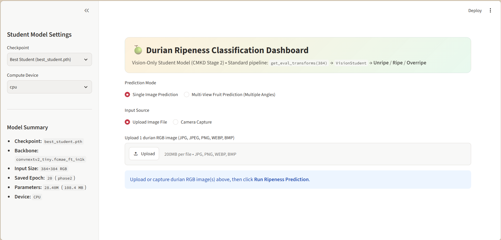
</p>

### 10.2 Single-Image Ripeness Prediction (`durian_001_SA_2_Unripe_rgb.jpg`)
When a single RGB image (e.g., side angle `SA` of `durian_001`) is uploaded, the image preview is centered above the **`Run Ripeness Prediction`** trigger. Running inference produces the verdict banner (**`Unripe (46.8%)`**), post-harvest guidance, inference latency (`146.6 ms` on CPU), horizontal probability bar chart, and per-class probability cards (`Unripe: 46.76%`, `Ripe: 29.35%`, `Overripe: 23.89%`).

<p align="center">
  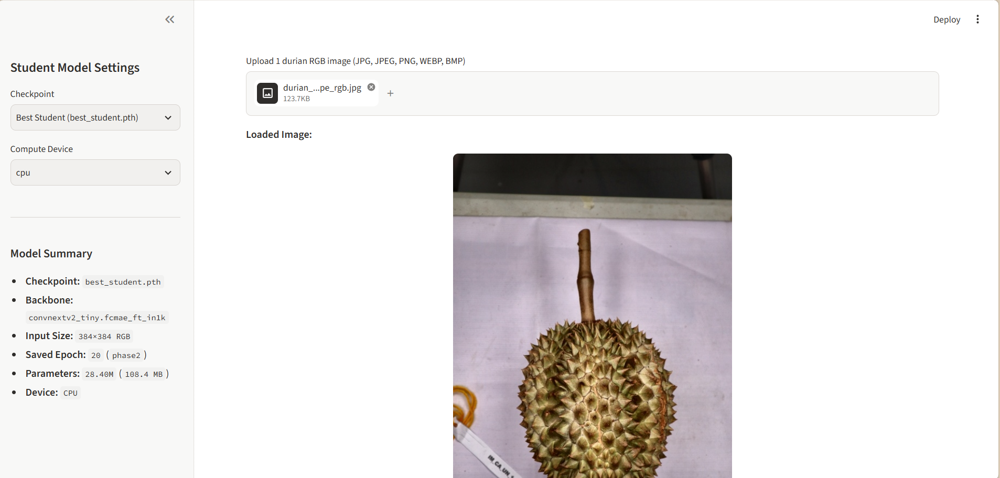
  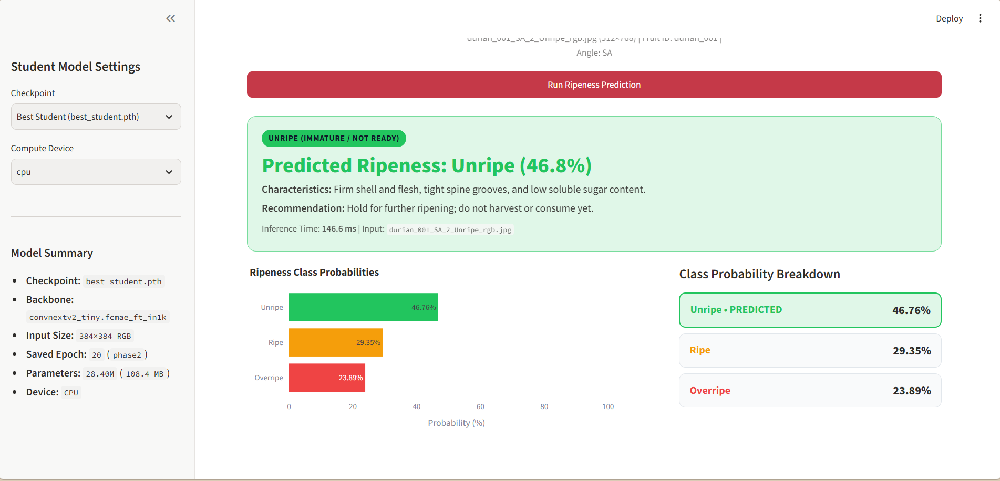
</p>

### 10.3 Multi-View Fruit-Level Aggregation (`durian_001` — 2 BOT Views)
Uploading multiple views of the same fruit lets the Student model score each viewpoint independently and aggregate predictions using **Mean Probability** (recommended) or **Majority Vote**. In this example combining `durian_001_BOT_2_Unripe_rgb.jpg` and `durian_001_BOT_Unripe_rgb.jpg`, mean-probability aggregation resolves the single-view ambiguity and correctly classifies the fruit as **`Unripe (36.13%)`** (`Angle Consistency: 50.0%`), rendering both the fruit-level breakdown and the grouped per-view bar chart with CSV export.

<p align="center">
  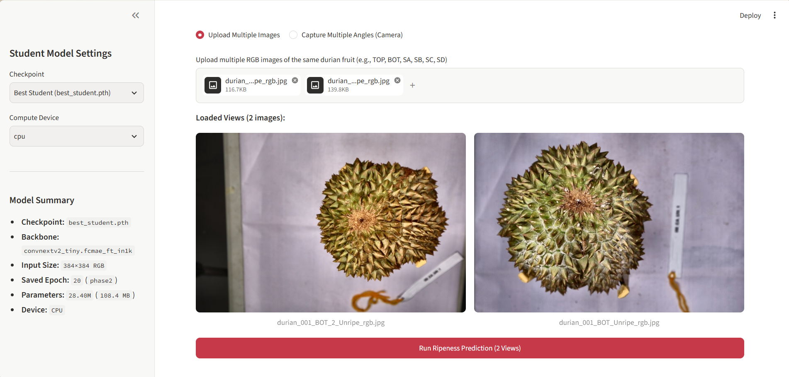
  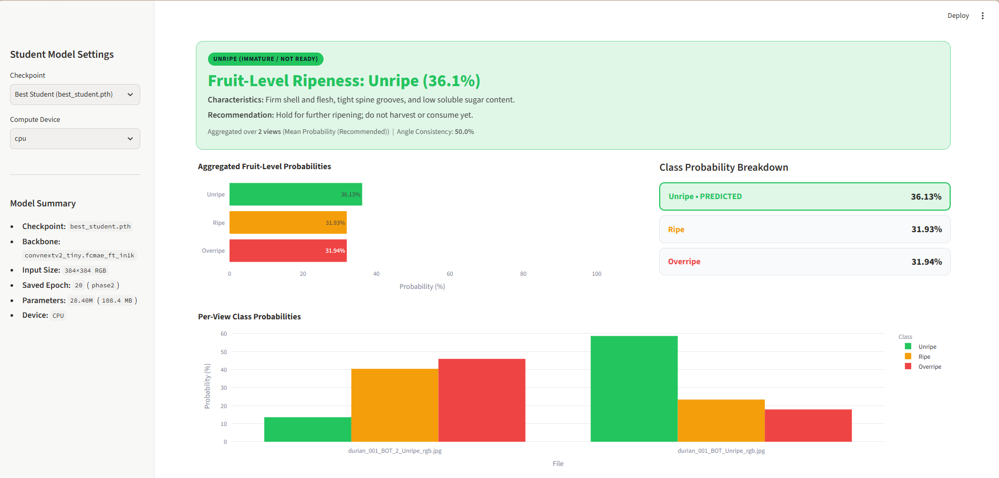
</p>

---

## 11. Citation & Acknowledgments

If you use this codebase or dataset in academic work, please cite the underlying **AIDurian** dataset:

```bibtex
@dataset{mesa_satina_2026_aidurian,
  author       = {Mesa-Satina, Armacheska R. and Kobayashi, Vladimer B. and Bayogan, Emma Ruth and Calag, Vicente B.},
  title        = {Multi-Modal Sensor Data for Durian Fruit Maturity Classification and Ripeness Assessment},
  year         = {2026},
  publisher    = {Zenodo},
  doi          = {10.5281/zenodo.18603796},
  url          = {https://doi.org/10.5281/zenodo.18603796}
}
```

---

## 12. Contributors & Team Members

| Member | Role & Track | GitHub Account | Primary Git Branch(es) | Key Contributions |
| :--- | :--- | :---: | :--- | :--- |
| **Nguyễn Hồ Quang Khải** | **Team Lead & Member 1**<br>*(Vision Track & CMKD Framework)* | [`@Cocobaut`](https://github.com/Cocobaut) | `cocobaut` | Vision EDA & LAB CLAHE preprocessing, `ConvNeXt V2` unimodal baseline, cross-modal alignment & `data/final/` builder, `MultiModalTeacher` (`CrossAttentionMultimodalFusion`) & `VisionStudent` CMKD training/Colab pipelines, modular Streamlit Dashboard (`app.py` + `visualization/`) |
| **Ngô Gia Bảo** | **Member 3**<br>*(Sensor / Thermal / Multispectral Track)* | [`@FazeBao`](https://github.com/FazeBao) | `Fazebao` | Tabular physicochemical correlation & permutation-importance EDA, Otsu thermal segmentation & 8-band NIR GeoTIFF feature extraction (`C_integrated19`), Unimodal Sensor MLP/RF ablation benchmarks, Student evaluation & deployment benchmark suite |
| **Nguyễn Trần Trọng Tuyên** | **Member 2**<br>*(Audio Track & Teacher XAI)* | [`@NTTT113`](https://github.com/NTTT113) *(ref: `ntt123`)* | `NTTT113/week1-audio-eda`<br>`NTTT113/week2-audio` | Acoustic knock metadata/MD5 audit & corruption filtering, Spectral Gating + Knock Envelope session-leakage mitigation, 3-seed 5-fold CV & Unimodal `ResNet-18` acoustic training, `TeacherEvaluator` & Grad-CAM explainability |
